# Project Axon on Cloudera Anywhere Cloud: Bank Branch Performance Analytics (Amazon S3 + AWS Glue)

An end-to-end analytics pipeline on **Cloudera Anywhere Cloud (AWC)** that turns raw bank branch and call-center data into governed tables, scheduled summaries, BI dashboards and AI-assisted insights.

Every Cloudera service runs as its own AWC experience. All data stays in one place, either **Amazon S3** or **Cloudera Object Store (COS, Ozone-based)**, and all metadata stays in one place, the **AWS Glue Data Catalog**.

---

## Table of contents

1. [What this project does](#1-what-this-project-does)
2. [Architecture](#2-architecture)
3. [Repository layout](#3-repository-layout)
4. [Prerequisites](#4-prerequisites)
5. [Step-by-step setup](#5-step-by-step-setup)
6. [Security notes](#6-security-notes)
7. [Troubleshooting](#7-troubleshooting)

---

## 1. What this project does

Bank branch teams need to see how every branch performs: revenue contribution, transaction times by type, channel preferences, customer status, seasonality and call-center load. The source data arrives as streaming records from a dummy generator and is assembled into a single, queryable analytics layer.

This project builds one connected path:

| Stage | AWC experience | What happens |
|---|---|---|
| Generate | Data generator app | Serves dummy bank and call-center records over an HTTP API |
| Ingest | Cloudera DataFlow (NiFi) | InvokeHTTP pulls the records and writes them to S3 |
| Store | Amazon S3 or Cloudera Object Store (Ozone) | Single copy of the data |
| Catalog | AWS Glue Data Catalog | External metastore holding databases and tables |
| Query | Cloudera Lakehouse Engine (Trino) | Reads Glue metadata and S3 data through the Hive connector |
| Explore | Cloudera Data Explorer (CDX) | Creates schemas and external tables, runs SQL |
| Transform | Cloudera Data Engineering (Spark) | Builds `callcenter_interaction_summary` for a given date |
| Schedule | Cloudera Workflow Orchestrator (Airflow) | Triggers the Spark job on a schedule |
| Visualize | Cloudera Data Visualization (CDV) | Branch Performance dashboard and AI Visual |
| AI | Cloudera AI Registry + Cloudera AI Inference | Hosts `Qwen/Qwen2.5-7B-Instruct` for AI Visual |

> Glue is used here as the external metastore, but the Lakehouse Engine can work with other external metastores in the same way.

## 2. Architecture

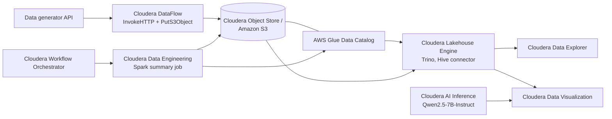

## 3. Repository layout

| Folder | Contents |
|---|---|
| `CDF/` | Combined NiFi flow definition (JSON) to upload into Cloudera DataFlow |
| `CLE/` | SQL queries run in Cloudera Data Explorer to create Glue databases and external tables |
| `CDE/` | Spark job files for the summary table |
| `CWO/` | Airflow DAG file |
| `CDV/` | Dashboard JSON files (Banking visual dashboard and AI visual dashboard) |
| `CAI/` | Text files with the model deployment arguments and prompts |
| `images/` | Screenshots used in this README |

## 4. Prerequisites

- A Cloudera Anywhere Cloud environment with these experiences deployed: DataFlow, Lakehouse Engine, Data Engineering, Workflow Orchestrator, Data Visualization, AI Registry and AI Inference.
- A **Linux server** to run the dummy data generator (see step 1).
- A storage target, one of:
  - an **Amazon S3 bucket** in the region you will use (examples use `us-west-1`), or
  - a **Cloudera Object Store (COS)** bucket exposed through its S3-compatible endpoint, with an access key and secret generated for it.
- An existing **AWS Glue Data Catalog** in the same region.
- An **AWS IAM user or role** with access to that bucket and catalog. At minimum it needs read/write on the bucket and Glue permissions to read and create databases, tables and partitions.
- Network access between the experiences (DataFlow to the generator API and S3, Lakehouse Engine to Glue and S3, Data Engineering to Glue and S3, Data Visualization to Lakehouse Engine and AI Inference).
- A GPU-backed AI Inference setup that can serve a 7B model.
- Access to the AWC API Explorer (needed in step 8).

---

## 5. Step-by-step setup

### Step 1. Deploy the dummy data generator

The data comes from the dummy data generator app of Cloudera's **Project Axon** (`cloudera/End2EndLabs`, folder `Project-Axon/assets`). It runs on a plain Linux server and exposes the HTTP endpoints used by DataFlow.

**1a. Linux server**

Use any running Linux server. A small cloud instance such as `t3.small` (2 vCPUs, 2 GB RAM) is enough. Open these ports in the server firewall or cloud security group:

| Ports |
|---|
| `8000`, `8085`, `5001`, `5003`, `5400`, `5500` |

Make sure the DataFlow (NiFi) cluster can reach the server on these ports.

**1b. Clone the repository**

```bash
sudo yum install -y python3 git
git clone https://github.com/cloudera/End2EndLabs.git
cd End2EndLabs/Project-Axon/assets
```

**1c. Set up the Python virtual environment**

```bash
python3 -m ensurepip --upgrade
python3 -m venv venv
source venv/bin/activate
pip3 install -r requirements.txt

# Verify Flask version
python3 -m flask --version
```

**1d. Run the application**

```bash
bash ../assets/run_all.sh
```

**1e. Verify the endpoints**

Replace `<your-server-ip>` with the public IP of the server:

```bash
curl http://<your-server-ip>:5400/footfall/summary
curl http://<your-server-ip>:8000/campaign-details
```

The campaign API returns JSON like this:

```json
{
  "Budget": 351527.55,
  "CampaignID": 17,
  "CampaignName": "Mclean-Tran Loan Offer",
  "Channel": "Bank Website",
  "EndDate": "2025-07-21",
  "SeasonID": 3,
  "StartDate": "2025-07-14",
  "Status": "Active"
}
```

Note the server IP and the port and path of each endpoint the flow will call (for example the call-center interaction endpoint). They go into the `InvokeHTTP` processors in step 2.

### Step 2. Ingest with Cloudera DataFlow into S3

1. Open the **Cloudera DataFlow** (Flow Management / NiFi) canvas.
2. Upload the combined flow from `CDF/` (flow definition JSON). It creates the process group `Project-axon-banking` with the `callcenter-flows` sub-group, which contains the `InvokeHTTP` processors and `PutS3Object`.
3. Create or edit the **parameter context** and set:

   | Parameter | Value |
   |---|---|
   | `s3.bucket` | Name of your S3 bucket |

   Also set the generator server IP, port and path on the InvokeHTTP processors (from step 1) if they are not parameterized.
4. Open **Controller Services** for the process group and configure `AWSCredentialsProviderControllerService`:

   | Property | Value |
   |---|---|
   | Use Default Credentials | `false` |
   | Access Key ID | your AWS access key ID |
   | Secret Access Key | your AWS secret access key |
   | Use Anonymous Credentials | `false` |

   Then **enable** it. Also enable the record readers and writers used by the flow (`JsonTreeReader`, `JsonRecordSetWriter`, `AvroReader`, `AvroRecordSetWriter`, `ParquetRecordSetWriter`).

   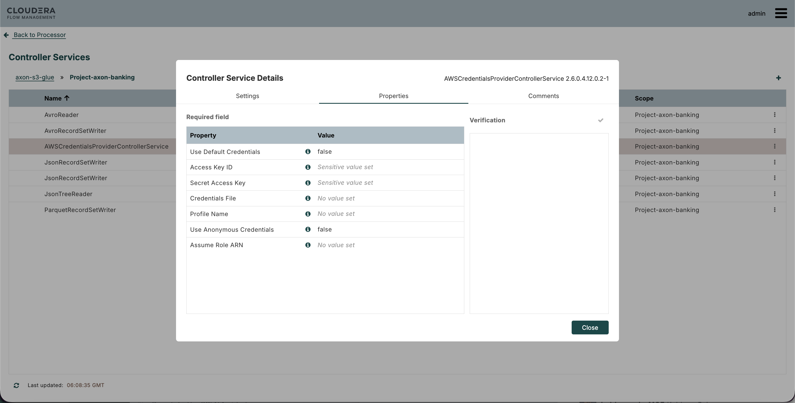
5. Check the `PutS3Object` processor:

   | Property | Value |
   |---|---|
   | Bucket | `#{s3.bucket}` |
   | Object Key | `s3_flow_data/CCL/callcenter/${filename}` (prefix as defined in the flow) |
   | Region | US West (N. California) |
   | AWS Credentials Provider service | `AWSCredentialsProviderControllerService` |
   | Resource Transfer Source | FlowFile Content |
   | Storage Class | Standard |
   | Server Side Encryption | None |

   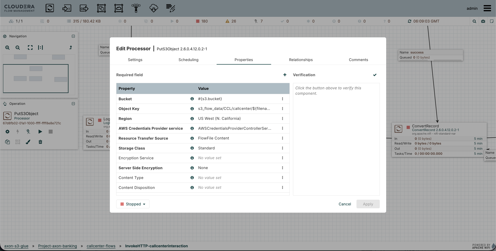
6. Start the processors. Confirm files appear under the object key prefix in your bucket.

#### Storage target: Amazon S3 or Cloudera Object Store (Ozone)

The same flow can write to **Cloudera Object Store (COS)** instead of Amazon S3. COS is Ozone-based and exposes an S3-compatible endpoint, so `PutS3Object` is reused and only the connection settings change.

| Setting on `PutS3Object` / credentials service | Amazon S3 | Cloudera Object Store (Ozone) |
|---|---|---|
| Bucket (`s3.bucket` parameter) | S3 bucket name | COS bucket name |
| Endpoint Override URL | leave empty | `<COS_S3_ENDPOINT>` (the COS S3-compatible endpoint) |
| Use Path Style Access | off | on |
| Access Key ID / Secret Access Key | AWS keys | keys generated for COS |
| Region | bucket region | the value your COS setup expects |
| SSL / certificates | public AWS certificates | the endpoint certificate must be trusted by NiFi if it is self-signed |

> Fill in the exact endpoint and key-generation steps for your COS deployment. Keep the same object key prefix so the tables in step 5 work for either target.

Whichever target you pick, use it consistently in steps 4, 5 and 6 below.

### Step 3. Prepare AWS Glue

An existing Glue Data Catalog is used. Nothing is created here by hand:

- Note the **AWS account ID** (the Glue catalog ID) and **region**.
- The Glue database and tables are created from Cloudera Data Explorer in step 5.

### Step 4. Connect Cloudera Lakehouse Engine (Trino) to Glue

1. Open **Cloudera Lakehouse Engine**, select your cluster and go to **Configurations**.
2. Add a configuration file named `glue.properties` (this makes a Trino catalog called `glue`) with:

   ```properties
   connector.name=hive
   fs.native-s3.enabled=true
   hive.metastore=glue
   hive.metastore.glue.aws-access-key=<AWS_ACCESS_KEY_ID>
   hive.metastore.glue.aws-secret-key=<AWS_SECRET_ACCESS_KEY>
   hive.metastore.glue.catalogid=<AWS_ACCOUNT_ID>
   hive.metastore.glue.region=us-west-1
   s3.aws-access-key=<AWS_ACCESS_KEY_ID>
   s3.aws-secret-key=<AWS_SECRET_ACCESS_KEY>
   s3.region=us-west-1
   ```

   **If the data is in Cloudera Object Store (Ozone)**, keep the `hive.metastore.glue.*` lines as they are (the metadata is still in AWS Glue), and point only the `s3.*` lines at COS:

   ```properties
   s3.endpoint=<COS_S3_ENDPOINT>
   s3.path-style-access=true
   s3.aws-access-key=<COS_ACCESS_KEY>
   s3.aws-secret-key=<COS_SECRET_KEY>
   s3.region=<COS_REGION_VALUE>
   ```
3. Click **Test Connection**. Wait for **Connection test succeeded**, then **Apply Changes**.

   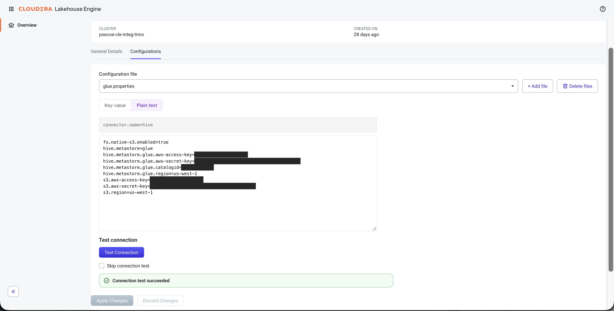

### Step 5. Create databases and external tables in Cloudera Data Explorer

1. Open **Cloudera Data Explorer (CDX)** and select the Lakehouse Engine (Trino) connection.
2. Run the queries from `CLE/` in order. They follow this pattern:

   ```sql
   -- Glue database (example name used by the Spark job)
   CREATE SCHEMA IF NOT EXISTS glue.callcenter_data_s3
   WITH (location = 's3://<S3_BUCKET>/');

   -- External table over the files written by DataFlow
   CREATE TABLE IF NOT EXISTS glue.callcenter_data_s3.callcenter_interaction (
       -- columns as defined in CLE/
   )
   WITH (
       external_location = 's3://<S3_BUCKET>/s3_flow_data/CCL/callcenter/',
       format = 'JSON'   -- must match the format DataFlow wrote
   );
   ```
3. Verify the data is visible:

   ```sql
   SELECT count(*) FROM glue.callcenter_data_s3.callcenter_interaction;
   SELECT * FROM glue.callcenter_data_s3.callcenter_interaction LIMIT 10;
   ```

   If the count is `0`, check the S3 path, file format and region.

### Step 6. Create the Spark summary job in Cloudera Data Engineering

1. Open **Cloudera Data Engineering** and create a job from the files in `CDE/`.
2. Settings:

   | Setting | Value |
   |---|---|
   | Job name | `CallcenterInteractionSummary` |
   | Application file | `CallCenterInteractionSummary_CDE.py` |
   | Runtime used in testing | Spark 4.1.1, Python 3.14, Iceberg 1.11.0, Java 17, Scala 2.13 |

3. **Arguments** (the first value is the date to summarize):

   ```text
   2026-01-26 --glue-database callcenter_data_s3 --source-table callcenter_interaction --summary-table callcenter_interaction_summary --aws-region us-west-1
   ```
4. **Spark configurations**:

   ```properties
   spark.dynamicAllocation.initialExecutors=1
   spark.hadoop.fs.s3a.bucket.<S3_BUCKET>.access.key=<AWS_ACCESS_KEY_ID>
   spark.hadoop.fs.s3a.bucket.<S3_BUCKET>.secret.key=<AWS_SECRET_ACCESS_KEY>
   spark.hadoop.fs.s3a.bucket.<S3_BUCKET>.aws.credentials.provider=org.apache.hadoop.fs.s3a.SimpleAWSCredentialsProvider
   spark.hadoop.fs.s3a.bucket.<S3_BUCKET>.endpoint=s3.us-west-1.amazonaws.com
   ```

   **For Cloudera Object Store (Ozone)**, use the COS bucket, endpoint and keys, and enable path-style access:

   ```properties
   spark.hadoop.fs.s3a.bucket.<COS_BUCKET>.endpoint=<COS_S3_ENDPOINT>
   spark.hadoop.fs.s3a.bucket.<COS_BUCKET>.path.style.access=true
   spark.hadoop.fs.s3a.bucket.<COS_BUCKET>.access.key=<COS_ACCESS_KEY>
   spark.hadoop.fs.s3a.bucket.<COS_BUCKET>.secret.key=<COS_SECRET_KEY>
   ```

   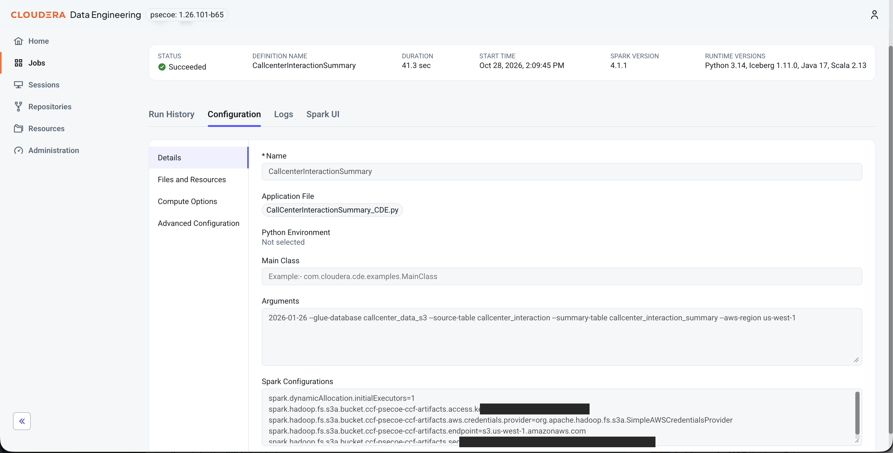
5. Run the job once. The status should show **Succeeded**, and `callcenter_interaction_summary` should be queryable from CDX.

### Step 7. Schedule it with Cloudera Workflow Orchestrator (Airflow)

1. Open **Cloudera Workflow Orchestrator** and upload the DAG file from `CWO/`.
2. Before the DAG can run, create the required Airflow connections in **CWO**:

   - `awc-cde`: create a connection for **CWO → CDE** communication. Provide the **CDE Jobs API URL** so the Airflow DAG can trigger and monitor the CDE Spark job.
   - `aws_glue`: create a connection for **CWO → AWS Glue** communication. Provide the **AWS access key ID**, **AWS secret access key**, and **AWS region** used by the Glue catalog.

3. Check the DAG settings: the CDE job name (`CallcenterInteractionSummary`), the Airflow connection to Cloudera Data Engineering, and the **schedule**.
4. Unpause the DAG and confirm the first scheduled run triggers the Spark job.

   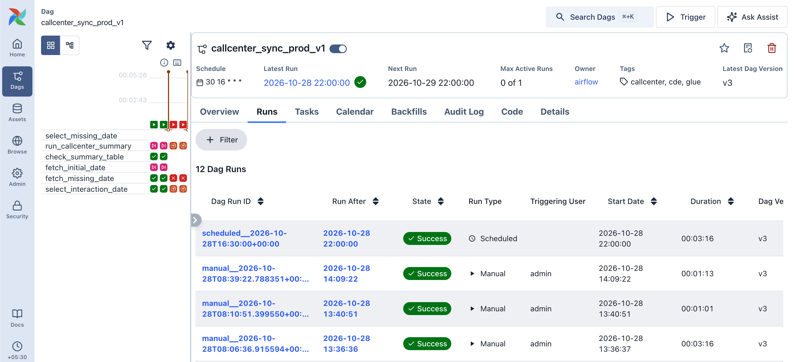

### Step 8. Connect Cloudera Data Visualization to Trino

**8a. Get an access token.** The connection uses JWT authentication.

1. Open the **AWC API Explorer**.
2. Under **Auth**, call the operation that **provisions an access key credential**.
3. Then call the operation that **exchanges the access key credential for an access token**.
4. Copy the token. It is time-limited, so generate a new one if the connection later fails with an authentication error.

**8b. Create the connection.** In CDV go to **Data → New connection**:

| Tab | Setting | Value |
|---|---|---|
| Basic | Connection type | Trino |
| Basic | Connection name | for example `trino-test` |
| Basic | Hostname | Lakehouse Engine endpoint |
| Basic | Port | `443` |
| Basic | Username | `admin` |
| Advanced | Socket type | SSL with certificate |
| Advanced | Allow Common Name - Host Name Mismatch | checked (only if your certificate needs it) |
| Advanced | Authentication mode | JWT |
| Advanced | JWT | the access token from 8a |
| Advanced | Socket timeout | `60` |

Click **Test**, then **Save**.

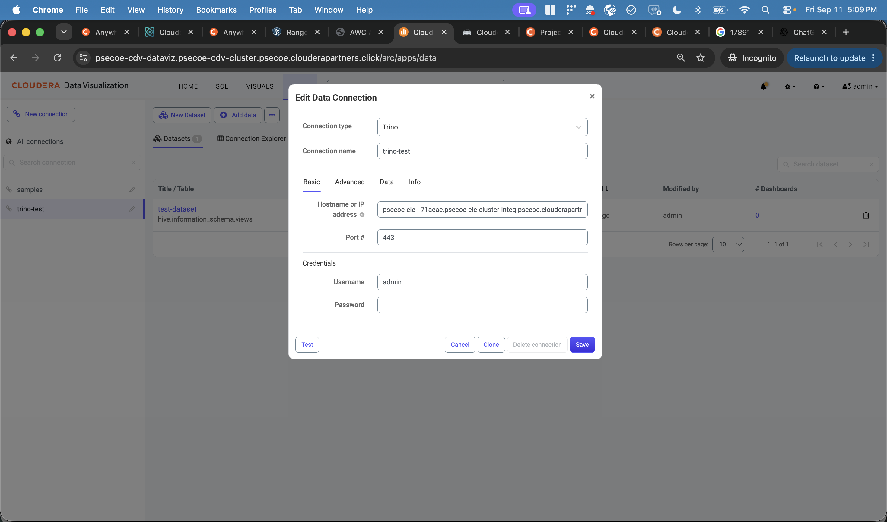
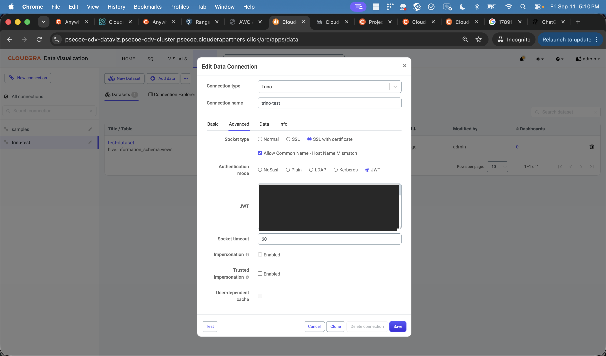

### Step 9. Import the dashboards

1. In CDV, use the import option for visual artifacts and upload the dashboard JSON files from `CDV/`: the **Banking visual dashboard** and the **AI visual dashboard**.
2. When asked, map the datasets to the Trino connection from step 8.
3. Open **Branch Performance Dashboard** and check that filters (branch name, record date) and charts load. It includes tabs for general analysis, department-wise analysis and call-center summary.

   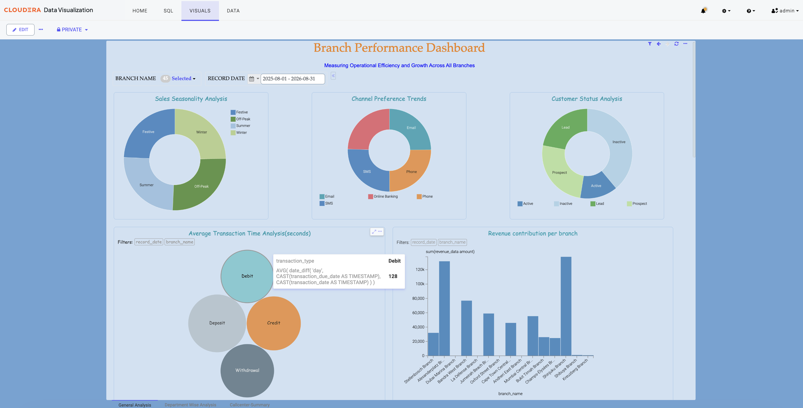
   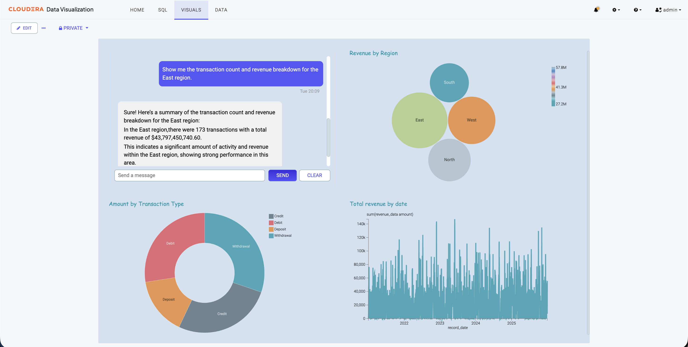

### Step 10. Deploy the AI model and enable AI Visual

**10a. Deploy the model**

1. Import `Qwen/Qwen2.5-7B-Instruct` from Hugging Face into **Cloudera AI Registry**.
2. Deploy it on **Cloudera AI Inference** with these arguments (also stored in `CAI/`):

   ```text
   --dtype half --tensor-parallel-size 1 --max-model-len 8192 --gpu-memory-utilization 0.85 --enforce-eager --enable-prefix-caching --enable-chunked-prefill --max-num-batched-tokens 1024
   ```
3. Note the **model endpoint URL**, an **access token** and the **model ID**.

**10b. Connect it to Data Visualization**

1. In CDV open **Site Settings → AI Settings → General** and enable **AI features** and **AI Visual**.
2. Go to **AI Settings → Completion** and click **Create Profile**:

   | Field | Value |
   |---|---|
   | Name | `CDVAI` |
   | Engine | Cloudera AI Inference |
   | API Key | the access token |
   | Service URL | the model endpoint |
   | Maximum tokens | `4000` |
   | Verify SSL certificates for AI service requests | off in testing; turn on with valid certificates |
   | Model | `Qwen/Qwen2.5-7B-Instruct` |
   | Temperature | `1` |
   | Enable Streaming Responses | on |
3. Click **Test**, then **Save**, and make the profile the default.

   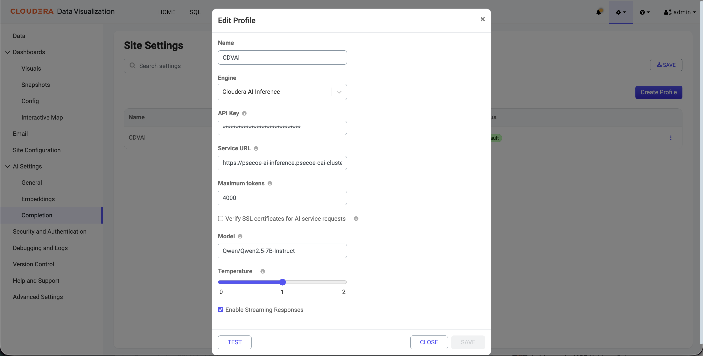
4. Open the AI visual dashboard and ask a question to confirm responses come back.

---

## 6. Security notes

- **Never commit real credentials.** This README uses placeholders such as `<AWS_ACCESS_KEY_ID>`. Keep real values in NiFi sensitive properties, Lakehouse Engine configuration, CDE secrets or a secure secret store instead of the repo.
- **Redact screenshots** before committing. Cover access keys, secret keys, account IDs, JWT tokens and API keys.
- Prefer an **IAM role with least privilege** over long-lived access keys where your environment supports it.
- Rotate any key that was ever shown in a screenshot, chat or commit.
- Turn on SSL certificate verification for AI service requests outside of testing.

## 7. Troubleshooting

| Symptom | Check |
|---|---|
| No files in the bucket | InvokeHTTP endpoint, `s3.bucket` parameter, credentials service is **enabled**, processors started |
| Trino connection test fails | Glue catalog ID, region, keys, and IAM permissions for Glue and S3 |
| External table returns 0 rows | `external_location` path, table `format` matches the files, region |
| COS only: connection or SSL errors | `Endpoint Override URL` / `s3.endpoint`, path-style access turned on, endpoint certificate trusted, keys generated for COS |
| Spark job fails on S3 access | The `spark.hadoop.fs.s3a.bucket.<bucket>.*` settings use the right bucket name |
| CDV connection fails | JWT expired, hostname, port `443`, socket type |
| AI Visual shows no answer | Completion profile test result, service URL, token, model ID |
